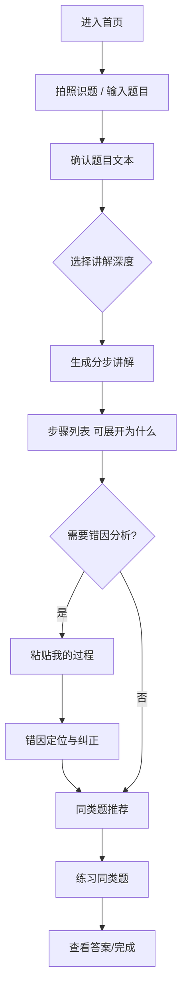

# 02 PRD：AI 数学学习助手（MVP）

> 版本：V0.1（MVP）｜ 作者：产品负责人 ｜ 日期：2025.10.15 ｜ 状态：评审通过

---

## 一、产品概述

### 1.1 产品定位
面向 **中学生/大学生** 的 AI 数学学习助手，解决"**解题跳步、无法按学生思路纠错**"两大痛点，提供"**拍照识题 → 分步讲解 → 错因分析**"闭环，帮助用户"看得懂、能纠错、会迁移"。

### 1.2 产品口号
> 不跳步地讲懂，顺着你的思路纠错。

### 1.3 目标用户
- **小航（作业救急型）**：初三，写作业卡壳，要快速、可看懂的分步讲解；
- **小雨（错题突破型）**：高二，反复错同类型题，需要错因定位与同类练习；
- **学长（概念钻研型）**：大二，需要严谨推导与"为什么"。

### 1.4 MVP 范围（来自 RICE P0/P1）
| 功能 | 编号 | 说明 |
| --- | --- | --- |
| 拍照识题 | F1 | 上传题目图片，识别题目文本（可编辑、可校对） |
| 分步讲解 | F2 | 完整步骤 + 每步可展开"为什么" + 深度三档 |
| 错因分析 | F3 | 学生提交自己的答案/过程，定位错因，纠正 + 同类题 |
| 同类题推荐 | F4 | 每道题给出 2–3 道同类练习（错一练三） |
| 答案折叠 | F5 | 默认折叠最终答案，防依赖 |

**非 MVP（V1.1）**：苏格拉底引导模式（R5）、错题本（R7）。
**远期（V1.2+）**：知识点图谱（R9）、多端形态（R10）。

---

## 二、用户故事（User Stories）

| 编号 | 用户故事 | 优先级 |
| --- | --- | --- |
| US1 | 作为小航，我希望拍照上传题目后系统能准确识别出题面，这样我不用手动敲公式 | P0 |
| US2 | 作为小航，我希望每一步都完整展示并可以点开"为什么"，这样我能真正看懂 | P0 |
| US3 | 作为小雨，我希望上传我写错的过程后，AI 能指出我错在哪一步、错因是什么，并示范正确做法 | P0 |
| US4 | 作为小雨，我希望系统推荐 2–3 道同类题，这样我能巩固直到不再错 | P1 |
| US5 | 作为学长，我希望选择"进阶"讲解深度并展开严谨推导，这样我能理解原理 | P1 |
| US6 | 作为所有用户，我希望最终答案默认折叠，这样我能先独立思考再对答案 | P1 |

---

## 三、核心功能需求与验收标准

### F1 拍照识题

**功能描述**：用户从相册上传/拍摄题目图片，系统识别题面文本并以可编辑形式展示；支持手写体与印刷体、常见公式（分数、根号、上下标）。

**交互流程**：
```
首页 → 点击"拍照识题" → 选择/拍摄图片 → 上传 → 识别中(loading) → 展示识别文本(可编辑)
      → 用户确认 → 进入解题流程
```

**验收标准**：

| 编号 | 验收项 | 标准 |
| --- | --- | --- |
| F1-AC1 | 图片上传 | 支持 jpg/png/webp ≤ 10MB；上传失败有明确提示且可重试 |
| F1-AC2 | 识别准确率 | 印刷体题目首轮识别准确率 ≥ 90%；手写体 ≥ 70%（基线，后续优化） |
| F1-AC3 | 可编辑校对 | 识别文本可在输入框编辑，支持 LaTeX 公式（如 `\frac{1}{2}`） |
| F1-AC4 | 识别耗时 | 识别结果 3 秒内返回（P90） |
| F1-AC5 | 异常处理 | 非数学内容/模糊图片给出提示："未识别到有效题目，请重新拍摄" |

---

### F2 分步讲解

**功能描述**：按"审题 → 建模 → 求解 → 检查"输出完整解题步骤；每步支持展开"为什么"；讲解深度三档（基础/标准/进阶）。

**交互流程**：
```
确认题目 → 选择讲解深度(基础/标准/进阶) → 生成讲解
→ 步骤列表(Step 1..n) → 点击某步展开"为什么" → 底部"查看答案"(默认折叠)
```

**验收标准**：

| 编号 | 验收项 | 标准 |
| --- | --- | --- |
| F2-AC1 | 步骤完整性 | 任意支持的题型，步骤数 ≥ 3 且无"跳到结果"的省略步；关键变形（移项、配方、通分等）必须单独成步 |
| F2-AC2 | 每步"为什么" | 每一步均附带可展开的原理说明（知识点/定理/口诀） |
| F2-AC3 | 深度三档 | 基础：多解释每一步的动作；标准：平衡；进阶：补充严谨推导与易错点 |
| F2-AC4 | 答案折叠 | 最终答案默认隐藏，点击"展开答案"才显示 |
| F2-AC5 | 正确性 | 样本题库 50 题内，最终答案正确率 100%（规则引擎）/ 95%+（LLM 模式需人工抽检） |

---

### F3 错因分析（差异化核心）

**功能描述**：用户粘贴自己的答案或错误过程，AI 与标准解法比对，定位错误步骤、判定错因类型（符号错误、移项未变号、计算失误、概念混淆、方法选择错误等），给出纠正示范与 2–3 道同类题。

**交互流程**：
```
解题页 → 点击"我的过程有错，帮我分析" → 粘贴/输入我的答案或过程 → 提交
→ 分析中(loading) → 错因卡片(错在哪儿/为什么错/怎么改) + 正确过程对比 + 同类题推荐
```

**验收标准**：

| 编号 | 验收项 | 标准 |
| --- | --- | --- |
| F3-AC1 | 错因定位 | 能指出错误发生在第几步/哪个表达式；定位准确率 ≥ 85%（内测样本） |
| F3-AC2 | 错因分类 | 输出标准化错因标签（见上文 6 类） |
| F3-AC3 | 纠正示范 | 给出"正确的下一步"并解释为什么这样改 |
| F3-AC4 | 同类题 | 每次推荐 2–3 道同类题，附带答案与讲解入口 |
| F3-AC5 | 无错误输入 | 若学生过程正确，提示"你的过程是对的"，并给出更优解法（如有） |
| F3-AC6 | 无关输入 | 输入与题目无关时，提示"请确认粘贴的是这道题的过程" |

---

### F4 同类题推荐

**功能描述**：基于题型与知识点标签，推荐同类练习（错一练三），并记录完成情况。

**验收标准**：每题推荐 2–3 道；推荐题与本题知识点匹配（人工抽检匹配率 ≥ 90%）；提供答案与解析。

### F5 答案折叠

**验收标准**：所有生成结果中"最终答案"默认折叠；可一键展开/收起；防依赖提示文案（"先自己想一想，再对答案"）。

---

## 四、整体交互流程（端到端）



## 五、信息架构与页面

| 页面 | 主要模块 |
| --- | --- |
| 首页 | 拍照识题入口、最近题目、讲解深度设置、模式切换 |
| 识别页 | 图片预览、识别文本编辑、确认按钮 |
| 讲解页 | 题目回显、步骤列表（每步可展开"为什么"）、答案折叠区、错因分析入口、同类题区 |
| 错因分析页 | 我的过程输入、错因卡片、正确过程对比、同类题推荐 |

## 六、非功能需求

| 类别 | 要求 |
| --- | --- |
| 性能 | 页面首屏加载 ≤ 2s；讲解生成 P90 ≤ 5s；弱网有 loading 与重试 |
| 兼容 | Chrome / Safari / Edge 最新两个版本；移动端优先自适应 |
| 安全合规 | 不上传用户隐私（自动脱敏）；题目图片仅用于识别，不用于训练（默认）；未成年人隐私合规 |
| 内容质量 | LLM 输出需经"步骤完整性/正确性"校验规则后展示；答案折叠防抄袭 |
| 可观测 | 埋点：识别成功率、讲解生成成功率、错因定位准确率（人工抽检）、功能使用率 |

## 七、数据指标（北极星 + 护栏）

- **北极星指标**：**周内"看懂率"** = 看完分步讲解后，能独立完成 1 道同类题的用户占比。
- 核心过程指标：识别成功率、讲解完整率、错因定位准确率、同类题完成率、7 日留存。
- 护栏指标：投诉率、错误讲解率（抽检）、答案直接复制率（越低越好，防止纯抄答案）。

## 八、里程碑

| 阶段 | 时间 | 交付 |
| --- | --- | --- |
| M1 调研与 PRD | 2025.09–10 | 调研报告、竞品分析、PRD |
| M2 原型 | 2025.10 | Figma 低/高保真原型（见 `docs/04-原型说明`） |
| M3 MVP 开发 | 2025.10–11 | 可交互 Demo（LLM API + 网页前端） |
| M4 内测与迭代 | 2025.11 | 10 人内测、评估指标采集、优化建议报告 |
