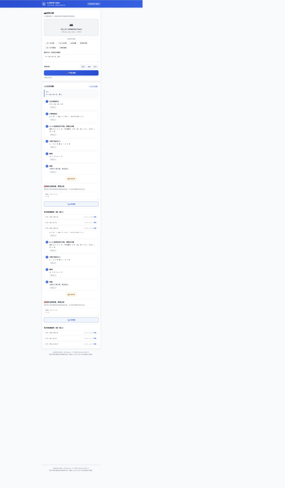

# 01 原型说明（Figma 低/高保真原型 ↔ Demo 对应关系）

> 本页说明原型设计思路，以及"Figma 静态原型"与"可交互 Demo"的对应关系。
> 由于 Demo 即高保真交互实现，以下页面在 `prototype/public/index.html` 中以同一套高保真界面呈现，可按交互真实操作。

---

## 一、原型层级

| 阶段 | 产出 | 工具 | 状态 |
| --- | --- | --- | --- |
| 低保真（Lo-fi） | 线框图：信息架构、页面布局、交互流程 | Figma | 已绘制 |
| 高保真（Hi-fi） | 视觉稿：配色、组件、移动端页面 | Figma | 已绘制 |
| 可交互 Demo | 高保真 + 真实功能（识别/讲解/错因分析） | HTML/CSS/JS + Node | 已实现 |

> Figma 文件含：首页、识别页、讲解页、错因分析页 4 个核心页面 + 组件库（步骤卡、错因卡片、答案折叠区、深度选择器）。

## 二、设计规范（Hi-fi）

| 项目 | 规范 |
| --- | --- |
| 主色 | 教学蓝 `#2563EB`（信任、理性）+ 强调橙 `#F59E0B`（提示/纠错） |
| 语义色 | 正确 `#16A34A`、错误 `#DC2626`、中性灰 `#6B7280` |
| 字体 | 中文：系统字体栈（PingFang SC / Microsoft YaHei）；公式：KaTeX 风格 LaTeX 文本 |
| 圆角/间距 | 卡片圆角 12px，页面左右留白 16px，步骤卡间距 12px |
| 交互反馈 | 生成中 skeleton loading；识别成功/失败 toast；步骤展开动画 200ms |
| 移动优先 | 375px 设计稿，Web 端自适应居中（max-width 560px） |

## 三、页面与 Demo 对应关系

| Figma 页面 | 关键元素 | Demo 中位置 |
| --- | --- | --- |
| 首页 | 拍照识题入口（大按钮）、示例题、深度设置、模式标签 | `index.html` 首屏 |
| 识别页 | 图片预览、识别文本（可编辑）、确认 | Demo「上传题目图片 / 选择示例题」后展示 |
| 讲解页 | 题目回显、步骤卡列表（可展开"为什么"）、答案折叠、错因分析入口 | Demo「开始讲解」后展示 |
| 错因分析页 | 我的过程输入框、错因卡片、正确过程对比、同类题 | Demo「错因分析」面板 |

## 四、低保真核心流程（Lo-fi 线框示意）

```
[首页]
┌─────────────────────────┐
│  AI 数学学习助手          │
│  [📷 拍照识题]            │
│  或 选择示例题 ↓          │
│  讲解深度: ○基础 ●标准 ○进阶 │
└─────────────────────────┘
         │ 上传图片
         ▼
[识别页]
┌─────────────────────────┐
│  识别结果(可编辑)          │
│  2x + 3 = 7              │
│  [确认，开始讲解]          │
└─────────────────────────┘
         │
         ▼
[讲解页]
┌─────────────────────────┐
│  Step1 移项到等号同侧 … [为什么▾] │
│  Step2 合并同类项 …      [为什么▾] │
│  Step3 系数化为1 …       [为什么▾] │
│  ── 答案 [展开] ──        │
│  [❌ 我的过程有错，帮我分析] │
└─────────────────────────┘
         │ 粘贴我的错误过程
         ▼
[错因分析页]
┌─────────────────────────┐
│  🎯 错因：移项未变号       │
│  你的第2步: 2x = 7+3  ← 应为 2x = 7−3 │
│  [正确做法] [同类题练习×2] │
└─────────────────────────┘
```

## 五、Demo 与 Figma 差异说明

- Demo 为可运行的完整实现，覆盖 Lo-fi 全部核心流程并补齐 Hi-fi 视觉；
- 识别功能在无外部 OCR 服务时使用"示例题 + 模拟识别"，接入 `LLM_API_KEY`（vision）后可识别真实上传图片；
- 讲解/错因分析默认使用内置规则引擎（离线可跑），配置真实 LLM API 后自动升级为真实推理。

---

## 六、Demo 运行截图



> 上图为本项目可交互 Demo 的「分步讲解 + 错因分析 + 同类题」页面实际渲染效果（运行于浏览器 1280px 视口）。
> 运行方式见 [prototype/README.md](../../prototype/README.md)。
