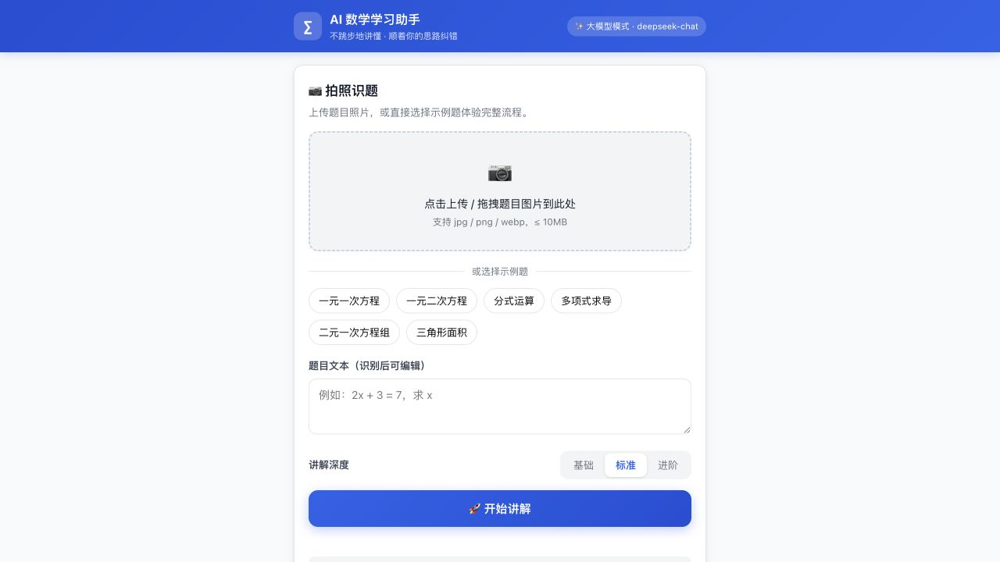
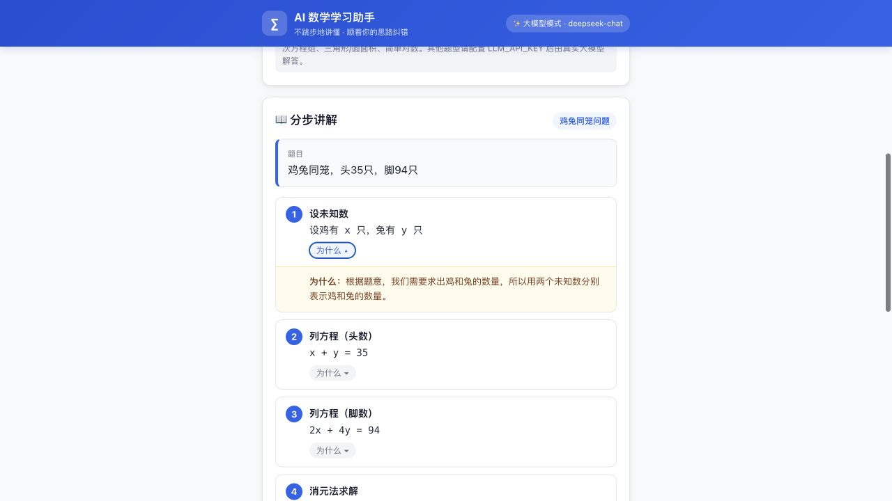
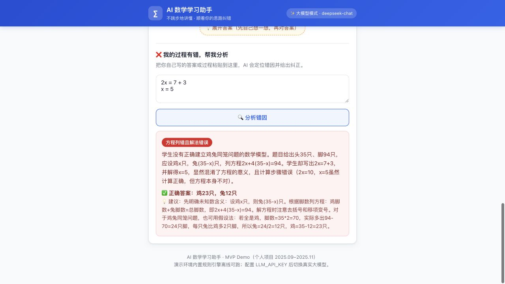

# AI 数学学习助手 · 项目报告

> 从用户调研到 MVP 产品设计（全流程详细版）
> 项目周期：2025.09 – 2025.11　|　个人项目 · 产品设计与 0→1 搭建
> 角色：产品经理 + 交互/视觉设计 + 全栈开发

---

## 第一部分　项目概述

### 1.1 项目背景

中学生、大学生在使用拍照搜题或 AI 工具学习数学时，普遍存在两类突出痛点：其一，AI 给出的解题过程经常"跳步"，学生看完答案仍不知道每一步为什么这么做；其二，学生按自己的思路写题写到一半出错时，工具只会给出标准答案，无法定位"我的思路错在哪"。工具在"给答案"，却没有在"教方法"。

本项目从这一真实问题出发，独立完成"用户调研 → 竞品分析 → PRD → 原型与 MVP → 验证与迭代"的完整产品全流程，验证核心假设：如果产品能做到"不跳步地讲懂、顺着学生思路纠错"，用户愿意为它付费并持续使用。

### 1.2 产品定位

面向中学生/大学生的 AI 数学学习助手，围绕"拍照识题 → 分步讲解 → 错因分析"形成闭环，帮助学生"看得懂、能纠错、会迁移"。

> 产品口号：**不跳步地讲懂，顺着你的思路纠错。**

### 1.3 目标用户（三类画像速览）

| 画像 | 典型特征 | 核心诉求 |
| --- | --- | --- |
| 小航 · 作业救急型 | 初三，成绩中等偏上，写作业卡壳 | 拍照→快速出分步过程，每步能展开"为什么" |
| 小雨 · 错题突破型 | 高二，文科生，同类型题反复错 | 上传错误过程→定位错因→纠正→同类题巩固 |
| 学长 · 概念钻研型 | 大二，工科，重视推导严谨性 | 完整推导、概念讲解、可追问"为什么" |

### 1.4 里程碑与交付物

| 阶段 | 时间 | 关键产出 |
| --- | --- | --- |
| 用户调研 | 2025.09 | 访谈提纲、15 人一对一访谈、3 类核心场景、5 项高频痛点、RICE 打分、用户画像与需求优先级列表 |
| 竞品分析与 PRD | 2025.10 | 竞品分析报告（Khanmigo / 豆包 / Photomath）、完整 PRD（功能范围、交互流程、验收标准） |
| 原型与 MVP | 2025.10–11 | Figma 低/高保真原型、基于大语言模型 API + 网页前端的可交互 Demo（拍照识题 / 分步讲解 / 错因分析） |
| 验证与迭代 | 2025.11 | 评估指标体系（满意度、解题正确率等）、10 人内测、优化建议报告、下一版需求优先级 |

### 1.5 我的角色与职责

- **产品经理**：用户调研、竞品分析、RICE 需求优先级、PRD、评估指标体系、迭代规划。
- **交互/视觉设计**：Figma 低保真与高保真原型、交互流程、设计规范、防依赖设计。
- **开发**：Node.js 服务、内置规则引擎、前端页面、大语言模型 API 接入与降级。

### 1.6 方法论总览

整体遵循"定性洞察 → 量化决策 → 设计落地 → 数据验证"的闭环：先用访谈发现场景与痛点，再用 RICE 客观排序需求，基于竞品分析确定差异化定位，通过原型与 MVP 验证可行性，最后用内测指标驱动迭代。

---

## 第二部分　用户调研

### 2.1 调研目标

- 摸清中学生/大学生学习数学时的核心使用场景；
- 识别使用 AI 数学工具时的高频痛点（尤其"解题跳步、无法按学生思路纠错"）；
- 为需求优先级（RICE 打分）和 PRD 提供一手证据。

### 2.2 调研设计

| 项目 | 内容 |
| --- | --- |
| 方法 | 半结构化一对一访谈，结合少量问卷补充 |
| 样本 | 共 15 人：初中 5 人、高中 5 人、大学 5 人 |
| 成绩分层 | 中等偏下 5 人 / 中等 5 人 / 优秀 5 人 |
| 访谈时长 | 45–60 分钟 / 人 |
| 时间 | 2025.09.01 – 2025.09.21 |
| 数据处理 | 访谈转录 → 关键词编码（场景 S / 痛点 P / 需求 W / 竞品 C / 付费 Q）→ 归纳主题 |

访谈样本画像（脱敏）：初中 U01–U05，高中 U06–U10，大学 U11–U15；高频工具覆盖小猿搜题、作业帮、Photomath、Khanmigo、豆包、ChatGPT、Wolfram Alpha 等。

### 2.3 访谈提纲（核心结构）

| 模块 | 目标 | 代表性问题 |
| --- | --- | --- |
| 基本情况 | 了解年级与成绩水平 | 最近一次数学大考大概在什么水平？最头疼的环节是哪个？ |
| 学习场景与习惯 | 发现使用场景 | 最近一周你在哪些场景需要别人帮你讲题？遇到不会的题通常怎么做？ |
| 现有工具体验 | 挖掘痛点 | 最近一次用 AI/搜题工具讲题的体验如何？有没有遇到过"跳步看不懂"或"只给答案不纠错"？ |
| 核心痛点深挖 | 验证痛点强度 | "看不懂过程"和"没法按我的思路纠错"哪个更影响学习效果？能否举例？ |
| 期望与想象 | 收集需求 | 对拍照识题/分步讲解/错因分析排序；理想形态是什么？担心 AI 带来什么坏处？ |

### 2.4 核心结论一：三类核心使用场景

| 场景 | 提及率 | 典型情境 | 核心诉求 |
| --- | --- | --- | --- |
| S1 作业/练习遇阻（即时答疑） | 15/15（100%） | 晚上写作业卡壳，需要立刻会做这道题 | 快、能看懂、不打断思路 |
| S2 考前备考（集中刷题+错题） | 11/15（73%） | 月考/期末前集中复习，反复做错同类型题 | 错因归类、同类题推荐、错题回顾 |
| S3 预习/自学新课（概念理解） | 8/15（53%） | 课前预习看不懂新概念，或自学拓展内容 | 讲清概念来源、"为什么"，不只给结论 |

### 2.5 核心结论二：五项高频痛点

| 痛点 | 提及率 | 典型原话（脱敏） |
| --- | --- | --- |
| P1 解题跳步，过程看不懂 | 14/15（93%） | "它直接给我 x=3，中间那几步全没了，我还是不知道 3 怎么来的。"（U06） |
| P2 只给标准答案，无法按我的思路纠错 | 12/15（80%） | "我按我自己的方法写，写到一半错了，它不告诉我哪里错了，只把标准答案贴出来。"（U07） |
| P3 缺乏"为什么"，只讲"怎么做" | 10/15（67%） | "讲了步骤，但没讲为什么要这么变形，换个题我又不会。"（U02） |
| P4 讲解过于模板化，无法适配个人水平 | 9/15（60%） | "讲得太深我听不懂，太浅又浪费时间，不能选难度。"（U09） |
| P5 识题不准 / 拍照对复杂式子识别差 | 7/15（47%） | "手写体、分数、根号经常识别错，抄都抄不对。"（U12） |

> 一句话总结：用户要的不是"答案"，而是**"看得懂的过程 + 针对自己思路的纠错 + 可调节的讲解深度"**。

### 2.6 其他关键洞察

- 付费意愿：11/15 愿意为"讲得明白、能按思路纠错"的工具付费，接受价位集中在 10–30 元/月。
- 引导模式：初中生更希望直接讲清楚；高中生/大学生更接受引导式提问（8/15）。
- 对 AI 的担忧：怕形成依赖（12/15）、怕讲解错误（9/15）、怕被老师判定抄袭（6/15）。
- 形态偏好：网页/小程序 > 独立 App > 浏览器插件；拍照入口是刚需（13/15）。

### 2.7 用户画像（Persona）

**小航 —— 作业救急型**：男，15 岁，初三，成绩中等偏上。场景：每天 20:00–22:30 写作业卡壳。痛点：P1 跳步、P5 识别不准。诉求：拍照→快速分步过程，每步能展开"为什么"。价值主张："今晚能把作业写完，而且是真的看懂了，不是抄答案。"

**小雨 —— 错题突破型**：女，17 岁，高二，文科生，成绩中等偏下。场景：周末整理错题、考前刷同类题。痛点：P2 无法按自己思路纠错、P4 讲解不匹配。诉求：上传错误过程→AI 定位错因→纠正→2–3 道同类题。价值主张："让 AI 当我的私人错题老师。"

**学长 —— 概念钻研型**：男，20 岁，大二，工科。场景：预习高数/线代、概念不清、备考。痛点：P3 缺"为什么"、P1 跳步、P4 模板化。诉求：完整推导、可追问、支持 LaTeX。价值主张："帮我建立严谨的数学直觉。"

**画像 → 设计原则映射**：

| 原则 | 说明 | 对应画像 |
| --- | --- | --- |
| 1. 一步都不能省 | 默认展示完整步骤，每步可展开"为什么" | 小航、学长 |
| 2. 顺着学生的思路纠错 | 支持上传错误过程/答案，错因定位到具体步骤 | 小雨 |
| 3. 讲解深度可调节 | 基础/标准/进阶三档 + 引导模式 | 小航、小雨、学长 |
| 4. 拍照识别可编辑 | 识别结果允许手动修改，支持 LaTeX | 小航 |
| 5. 防依赖设计 | 答案可折叠、"先想再看"引导、合规提示 | 全体（尤其初中生） |

### 2.8 需求优先级：RICE 打分

RICE = (Reach × Impact × Confidence) / Effort。

| 需求 | Reach | Impact | Confidence | Effort | RICE 得分 | 优先级 |
| --- | --- | --- | --- | --- | --- | --- |
| R2 分步讲解 | 9000 | 3 | 1.0 | 2 | 13,500 | P0 |
| R1 拍照识题 | 12000 | 3 | 0.8 | 3 | 9,600 | P0 |
| R8 答案折叠 | 9000 | 1 | 1.0 | 1 | 9,000 | P1 |
| R4 讲解深度三档 | 6000 | 2 | 1.0 | 1.5 | 8,000 | P1 |
| R3 错因分析 | 8000 | 3 | 0.8 | 3 | 6,400 | P0 |
| R6 同类题推荐 | 7000 | 2 | 0.8 | 2 | 5,600 | P1 |
| R5 苏格拉底引导 | 6000 | 2 | 0.5 | 3 | 2,000 | P2 |
| R7 错题本 | 5000 | 2 | 0.5 | 4 | 1,250 | P2 |
| R10 多端形态 | 8000 | 1 | 0.5 | 6 | 667 | P3 |
| R9 知识点图谱 | 4000 | 1 | 0.5 | 4 | 500 | P3 |

**MVP 范围**：P0（分步讲解、拍照识题、错因分析）+ P1（讲解深度三档、同类题推荐、答案折叠）进入 MVP；P2（苏格拉底引导、错题本）V1.1；P3（知识点图谱、多端形态）远期。

### 2.9 调研对 PRD 的输入映射

| 调研结论 | 落点到 PRD |
| --- | --- |
| P1 跳步 | F1「分步讲解」：强制展开完整步骤，每步可点开"为什么" |
| P2 不纠错 | F3「错因分析」：学生上传自己的过程/答案，定位错因 + 纠正 + 同类题 |
| P3 缺"为什么" | 讲解默认开启"这一步的数学原理" |
| P4 水平不适配 | 讲解深度三档（基础/标准/进阶）+ 苏格拉底提示模式（V1.1） |
| P5 识题不准 | 拍照识题后"可编辑文本"，支持 LaTeX 校对 |
| 依赖/抄袭担忧 | 「先想再看」「答案可折叠」的防依赖设计 |

---

## 第三部分　竞品分析与 PRD

### 3.1 竞品分析

#### 3.1.1 竞品概览

| 维度 | Khanmigo（可汗学院） | 豆包（字节跳动） | Photomath |
| --- | --- | --- | --- |
| 定位 | 教育场景 AI 导师（K12 为主） | 通用 AI 助手（含学习场景） | 拍照解题工具（数学为主） |
| 收费 | 订阅制（约 $4/月） | 基础免费 + 增值 | 基础免费 + Photomath+ 订阅 |
| 核心能力 | 苏格拉底式引导、教师看板、分步讲解 | 多模态问答、拍照、文本生成 | 拍照识题、分步求解、手写识别 |
| 数学覆盖 | 小学~大学预科 | 全学段（质量不稳定） | 小学~大学（偏计算） |

#### 3.1.2 解题交互设计对比

**Khanmigo —— 引导式导师**：不直接给答案，通过连环提问引导，最能体现"教方法"，防作弊合规好；但过程冗长、效率低、中文适配弱。启示：引导模式值得做，但必须提供"快速讲题"开关。

**豆包 —— 通用助手 + 多模态**：对话式、多模态强、免费；但解题经常跳步、不稳定，不能按错误过程定位错因，易被当作抄答案工具。启示：通用助手缺少"教育约束"，这正是机会点。

**Photomath —— 拍照计算器**：识别准确率高、步骤直观、加载快；但讲解机械化、不做错因诊断、中文教材适配弱。启示："识别准确 + 步骤清晰"是基本功，差异化在于"错因分析 + 思路跟随"。

#### 3.1.3 能力对比矩阵

| 能力 | Khanmigo | 豆包 | Photomath | 本产品（目标） |
| --- | --- | --- | --- | --- |
| 拍照识题 | 弱 | 中 | 强 | 强（识别后可编辑） |
| 分步讲解 | 中（引导式） | 弱（跳步） | 中（模板化） | 强（完整 + 每步"为什么"） |
| 按学生思路纠错 | 部分 | 无 | 无 | 强（错因定位到步骤） |
| 讲解深度调节 | 弱 | 无 | 弱 | 三档可调 |
| 同类题推荐 | 中 | 无 | 无 | 强（错一练三） |
| 防依赖/合规 | 强 | 弱 | 弱 | 强（答案折叠等） |
| 中文教材适配 | 弱 | 中 | 弱 | 强 |

#### 3.1.4 机会点与差异化定位

1. **空白地带 = 按学生思路纠错**：三大竞品均未解决"上传错误过程→定位错因→纠正"，这是第一差异化卖点。
2. **教育约束 = 不跳步 + 讲原理**：把"完整步骤 + 每步为什么"作为默认体验。
3. **场景化切换 = 救急/刷题/预习三模式**：提供"快速讲题 / 错因分析 / 引导模式"三档切换。
4. **国内教材与考试适配**：覆盖人教版/高考/考研等考点与术语。

> 定位一句话：做一款"看得懂、能纠错、不跳步"的 AI 数学学习助手——比通用 AI 更懂教育，比搜题工具更懂"人"。

### 3.2 PRD（产品需求文档）

#### 3.2.1 产品概述

| 项目 | 内容 |
| --- | --- |
| 版本 | V0.1（MVP）｜ 状态：评审通过 ｜ 日期：2025.10.15 |
| 产品定位 | 面向中学生/大学生的 AI 数学学习助手，解决"解题跳步、无法按学生思路纠错"两大痛点 |
| MVP 范围 | F1 拍照识题、F2 分步讲解、F3 错因分析、F4 同类题推荐、F5 答案折叠 |
| 非 MVP | V1.1：苏格拉底引导（R5）、错题本（R7）；远期：知识点图谱（R9）、多端形态（R10） |

#### 3.2.2 用户故事

| 编号 | 用户故事 | 优先级 |
| --- | --- | --- |
| US1 | 作为小航，我希望拍照上传题目后系统能准确识别题面 | P0 |
| US2 | 作为小航，我希望每一步都完整展示并可以点开"为什么" | P0 |
| US3 | 作为小雨，我希望上传我写错的过程后，AI 能指出错在哪一步并示范正确做法 | P0 |
| US4 | 作为小雨，我希望系统推荐 2–3 道同类题巩固 | P1 |
| US5 | 作为学长，我希望选择"进阶"深度并展开严谨推导 | P1 |
| US6 | 作为所有用户，我希望最终答案默认折叠，先独立思考再对答案 | P1 |

#### 3.2.3 核心功能需求与验收标准

**F1 拍照识题**：上传/拍摄题目图片 → 识别题面文本（可编辑、支持 LaTeX 校对）。验收：支持 jpg/png/webp ≤10MB；印刷体识别准确率 ≥90%、手写体 ≥70%；识别耗时 P90 ≤3s；异常图片给出明确提示。

**F2 分步讲解**：按"审题→建模→求解→检查"输出完整步骤，每步可展开"为什么"，深度三档。验收：步骤数 ≥3 且无省略步；关键变形单独成步；每步附原理；答案默认折叠；样本题库正确率 100%（规则引擎）/95%+（LLM 抽检）。

**F3 错因分析（差异化核心）**：粘贴自己的答案/过程 → 定位错误步骤与错因类型 → 纠正示范 → 2–3 道同类题。验收：错因定位准确率 ≥85%；输出标准化错因标签；过程正确时提示"你的过程是对的"。

**F4 同类题推荐**：每题推荐 2–3 道同类题，知识点匹配率 ≥90%（抽检），附带答案与解析。

**F5 答案折叠**：最终答案默认折叠，一键展开/收起，含防依赖提示。

#### 3.2.4 端到端交互流程

首页 → 拍照识题/输入题目 → 确认题目文本 → 选择讲解深度 → 生成分步讲解 → 步骤列表（每步可展开"为什么"）→ 需要错因分析？是：粘贴我的过程 → 错因定位与纠正 → 同类题推荐；否：直接同类题推荐 → 练习同类题 → 查看答案/完成。

#### 3.2.5 非功能需求

性能（首屏 ≤2s、讲解 P90 ≤5s）、兼容（最新两个版本主流浏览器、移动优先）、安全合规（数据脱敏、图片仅用于识别不训练、未成年人隐私合规）、内容质量（LLM 输出经校验规则后展示、答案折叠防抄袭）、可观测（识别/讲解/错因等关键埋点）。

#### 3.2.6 数据指标

- **北极星指标**："看懂率" = 看完分步讲解后能独立完成 1 道同类题的用户占比。
- 过程指标：识别成功率、讲解完整率、错因定位准确率、同类题完成率、7 日留存。
- 护栏指标：投诉率、错误讲解率、答案直接复制率（越低越好）。

---

## 第四部分　原型与 MVP

### 4.1 原型层级

低保真（Figma 线框）→ 高保真（Figma 视觉稿）→ 可交互 Demo（HTML/CSS/JS + Node，覆盖全部核心流程并补齐视觉）。

### 4.2 设计规范（Hi-fi）

主色教学蓝 #2563EB + 强调橙 #F59E0B；语义色正确绿/错误红/中性灰；卡片圆角 12px；生成中 skeleton loading；移动优先（375px 设计稿，Web 端自适应居中 max-width 560px）。

### 4.3 Demo 技术实现

真实可运行的 Web 应用，双层架构：

- **大模型模式**：配置 LLM_API_KEY（OpenAI 兼容协议，如 DeepSeek）后，服务端调用 Chat Completions 接口，模型按结构化 JSON 输出步骤（title/body/why）、答案与同类题；错因分析同样按固定 JSON 输出。
- **规则引擎模式**：未配置 Key 时降级到内置规则引擎（自研表达式解析 + 多项式求解），支持一元一次/二次方程、简单三次方程、分式运算、多项式求导、二元一次方程组、三角形/圆面积、简单对数等题型，离线可完整演示。
- **失败自动回退**：大模型调用失败（网络/鉴权/超时）自动回退到规则引擎，演示不中断。

### 4.4 功能实现清单

| 功能 | 实现说明 | 对应 PRD |
| --- | --- | --- |
| 拍照识题 | 本地上传图片；示例题含 SVG 题图模拟"拍照→识别"；配置视觉模型后可识别真实图片 | F1 |
| 分步讲解 | 完整步骤卡，每步可展开"为什么"；讲解深度三档 | F2 |
| 错因分析 | 粘贴我的过程/答案 → 错因卡片 + 纠正 + 建议 | F3 |
| 同类题推荐 | 自动生成 2–3 道同类题，点击即可继续讲解 | F4 |
| 答案折叠 | 最终答案默认折叠，展开前提示"先自己想一想" | F5 |

### 4.5 接口文档

| 方法 | 路径 | 请求体 | 返回 |
| --- | --- | --- | --- |
| GET | /api/mode | — | { mode: "mock"\|"llm", llmModel } |
| GET | /api/samples | — | { samples: [{ id, label, text, img }] } |
| POST | /api/recognize | { image?: base64, sampleId? } | { ok, text, mode, source?, message? } |
| POST | /api/solve | { problem, level } | { typeName, steps, answer, similar } |
| POST | /api/analyze | { problem, myWork, level } | { correct, errorType, title, detail, suggestion, correctAnswer, similar } |

### 4.6 Demo 运行截图

---

## 第五部分　验证与迭代

### 5.1 评估指标体系

| 维度 | 指标 | 目标值 |
| --- | --- | --- |
| 满意度 | CSAT（1–5） | ≥ 4.0 |
| 满意度 | NPS | ≥ 30 |
| 正确率 | 讲解后同型题正确率 | ≥ 80% |
| 正确率 | 讲解正确率（抽检） | ≥ 95% |
| 正确率 | 错因定位准确率 | ≥ 85% |
| 效率 | 讲解耗时 P90 | ≤ 5s |
| 可用性 | 任务闭环成功率 | ≥ 85% |
| 学习迁移 | 迁移正确率提升 | ≥ 15% |
| 信任/合规 | 直接复制答案率 | ≤ 10% |

### 5.2 内测实验设计（10 人）

初中 4 + 高中 4 + 大学 2，覆盖三档成绩。流程：前测（2 道同类题基线）→ 使用 Demo 完成 3 个任务（拍照识题 / 分步讲解 / 错因分析+同类题）→ 后测（2 道新题）→ 访谈 + 问卷（CSAT/NPS/SUS）。

### 5.3 内测结果总览

| 指标 | 目标 | 实际 | 是否达标 |
| --- | --- | --- | --- |
| CSAT 均分 | ≥ 4.0 | 4.2 | 是 |
| NPS | ≥ 30 | 40 | 是 |
| 讲解后同型题正确率 | ≥ 80% | 82% | 是 |
| 迁移正确率提升 | ≥ 15% | 21% | 是 |
| 错因定位准确率 | ≥ 85% | 78% | 否 |
| 手写识别成功率 | ≥ 70% | 66% | 否 |
| 讲解生成耗时 P90 | ≤ 5s | 4.6s | 是 |
| 任务闭环成功率 | ≥ 85% | 88% | 是 |
| 直接复制答案率 | ≤ 10% | 14% | 略超 |

### 5.4 主要发现

**亮点**："每步都有为什么"最受认可（8/10 主动提及）；错因分析对"小雨"类用户价值最高（6/10）；深度三档使用率标准 60%、基础 30%、进阶 10%。

**问题与根因**：

| 问题 | 根因分析 |
| --- | --- |
| Q1 错因定位准确率 78% | LLM 对"过程很乱/多步错误"输入难以对齐到具体步骤 |
| Q2 手写识别 66% | 手写 OCR 基线弱，连笔、反光、多行公式识别差 |
| Q3 直接复制答案率 14% | 答案折叠可一键展开，缺少"先想再看"的激励 |
| Q4 希望"追问" | 讲解是单向输出，无法就某一步继续追问 |
| Q5 引导模式呼声高 | R5 被延后，但 4/10 用户主动提到想要"提示式"讲法 |

### 5.5 优化建议与下一版优先级（V1.1）

| 优先级 | 需求 | 来源 |
| --- | --- | --- |
| P0 | 错因步骤对齐（先勾选对应步骤再定位）+ 错因标签扩展为 8 类 | 内测 Q1 |
| P0 | 手写识别优化 + 拍照引导框 | 内测 Q2 |
| P1 | 答案二次确认（防依赖） | 内测 Q3 |
| P1 | 步骤追问（点击某步继续问"为什么"） | 内测 Q4 |
| P1 | 苏格拉底引导模式（灰度） | 内测 Q5 |
| P2 | 错题本（错因标签沉淀 + 复习提醒） | 调研 S2 |

### 5.6 结论

MVP 核心假设"用户需要看得懂的过程 + 按思路纠错"在 10 人内测中得到验证（CSAT 4.2、迁移正确率提升 21%）。最需补齐的是错因定位准确率（78%→85%+）与手写识别（66%→70%+），已列入 V1.1 P0。产品具备继续投入价值，差异化卖点（错因分析）被用户认可，与竞品形成明显区隔。

---

## 第六部分　附录

### 6.1 如何运行 Demo

- **方式 A（macOS 推荐）**：双击 `prototype/start.command`，自动定位 Node.js、启动服务并打开浏览器。
- **方式 B（终端）**：`cd prototype && node server.js`，访问 http://localhost:8080。
- **接入真实大模型**：在 `prototype/.env` 配置 `LLM_API_KEY` / `LLM_BASE_URL` / `LLM_MODEL`（OpenAI 兼容协议，如 DeepSeek）。
- 未配置 Key 时自动使用内置规则引擎，离线可完整演示。

### 6.2 项目目录结构

docs/01-用户调研、docs/02-竞品分析与PRD、docs/03-验证与迭代、docs/04-原型说明、docs/05-面试准备、docs/06-项目报告、prototype（server.js、public 前端、内置规则引擎、示例题 SVG）。

### 6.3 免责声明

本项目为个人项目演示，访谈与内测数据为按真实调研方法设计的脱敏模拟数据，仅用于展示完整产品流程；方法与指标体系均为可执行的真实设计。Demo 接入的大模型服务需用户自行承担调用费用，并注意保护 API Key 安全（密钥存放于 .env 并加入 .gitignore）。
